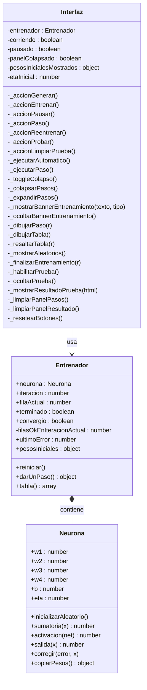

# Perceptrón Simple — Y = X1 AND (X2 OR X3 OR X4)

Demostración paso a paso del entrenamiento de un perceptrón simple con función
de activación **tanh** que aprende la función booleana bipolar
`Y = X1 AND (X2 OR X3 OR X4)`.

Desarrollado en HTML, CSS y JavaScript.

---

## Autores

- Kevin Felipe Zambrano Guaca
- Sara Milena Arévalo Cristancho
- Samuel Ortiz Ospina

---

## Ecuaciones utilizadas

| Concepto | Ecuación |
|---|---|
| Sumatoria con bias | `net = w1·x1 + w2·x2 + w3·x3 + w4·x4 + b` |
| Activación | `y = tanh(net)` |
| Función a trozos | `Y = 1` si `y ≥ 0`; `Y = −1` si `y < 0` |
| Error | `error = d − Y` (solo puede valer 0, 2 ó −2) |
| Corrección de pesos | `wi = wi + η · error · xi` (i = 1...4) |
| Corrección del bias | `b = b + η · error` |

---

## Flujo de entrenamiento

1. Se asignan pesos `w1...w4`, bias `b` y tasa `η` (factor de aprendizaje) de forma **aleatoria**.
2. En cada iteración se recorre la tabla de verdad fila por fila.
3. Si el error es **0** en una fila, se avanza a la siguiente.
4. Si el error es **≠ 0**, se corrigen los pesos y se reinicia desde la fila 1
   (eso cuenta como una iteración completa).
5. Si se completan las 16 filas sin ningún error, el perceptrón **convergió**.
6. Máximo **999 iteraciones**; si se supera, se informa y se permite reentrenar.

---

## Archivos

```
index.html   — estructura HTML
style.css    — estilos responsivos
neurona.js   — clase Neurona (modelo matemático)
entrenador.js — clase Entrenador (lógica del problema)
interfaz.js  — clase Interfaz (UI, sin cálculos propios)
README.md    — este archivo
```
---

## Diagrama de clases


